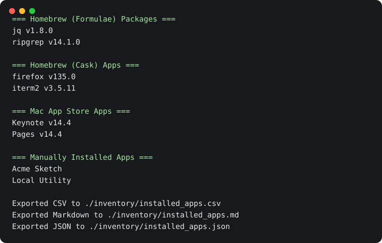

# list-macOS-apps

Inventory macOS applications from Homebrew, the Mac App Store, and local Applications folders. Print one sorted list or export the same inventory to CSV, Markdown, and JSON.

[](https://github.com/alsd4git/list-macOS-apps/actions/workflows/tests.yml)
[](LICENSE)

## Features

- Lists Homebrew casks.
- Lists Mac App Store applications when `mas` is available.
- Lists manually installed `.app` bundles from `/Applications` and `~/Applications`.
- Optionally includes Homebrew formulae.
- Exports the same canonical inventory to CSV, Markdown, and JSON.

The inventory combines package-manager entries with `.app` bundles found in Applications folders. It removes manual-app duplicates for names reported by Homebrew casks and the Mac App Store.

## Requirements

- macOS
- Bash
- `brew` for Homebrew sections
- `mas` for Mac App Store sections
- `jq` to match cask-installed `.app` bundles and avoid duplicate manual-app entries

The script does not install dependencies automatically. If a command is not available, the related section is skipped with a warning.

## Usage

```bash
git clone https://github.com/alsd4git/list-macOS-apps.git
cd list-macOS-apps
./list-installed-apps.sh
```

To export all sections in all three formats, create an output directory and run:

```bash
mkdir -p ./inventory
./list-installed-apps.sh --with-formulae \
  --export-csv --export-md --export-json \
  --output-dir ./inventory
```

The command prints each section to the terminal and writes `installed_apps.csv`, `installed_apps.md`, and `installed_apps.json` into `./inventory`. Review these files before sharing them. They contain names from your installed-app inventory.

## Example

This preview comes from the real script with synthetic `.app` directories and mocked `brew` and `mas` commands. It does not contain a scan of a real Mac. Regenerate it with `./scripts/generate-readme-demo.sh`.



The matching synthetic JSON export is available at [docs/demo-inventory.json](docs/demo-inventory.json).

## Options

- `--with-formulae`: Include Homebrew formulae in the output.
- `--export-csv`: Export the inventory to `installed_apps.csv`.
- `--export-md`: Export the inventory to `installed_apps.md`.
- `--export-json`: Export the inventory to `installed_apps.json`.
- `--output-dir DIR`: Write export files into `DIR`.
- `--help`: Print usage information.

For a reproducible inventory of a mounted volume or a test fixture, set `APPLICATIONS_DIRS` to a colon-separated list of folders. When it is unset, the script scans `/Applications` and `~/Applications` on the machine where it runs. Use a dedicated output directory, and check the destination before exporting.

## Output model

All output formats are generated from a single internal inventory model so app names with spaces, Mac App Store entries, and manual-app deduplication stay consistent across console output and exports.

## Development

Validation commands from the repository root:

```bash
bash -n list-installed-apps.sh
shellcheck list-installed-apps.sh
./tests/test-list-installed-apps.sh
./scripts/generate-readme-demo.sh
```

## License

This project is licensed under the MIT License. See [LICENSE](LICENSE).
